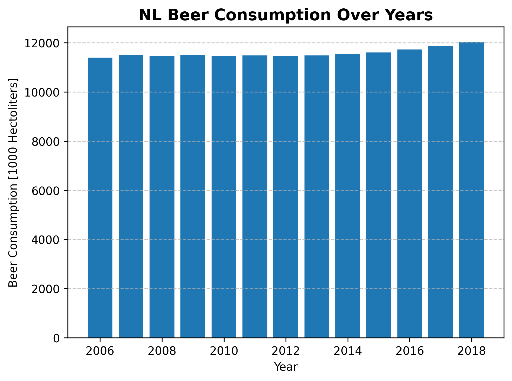

# student nr.
1685073

# references
- MCC Van Dyke et al., 2019
- JT Harvey, Applied Ergonomics, 2002
- DW Ziegler et al., 2005

# Interpretation
The annual beer consumption in the Netherlands seems to be constant in the inital 10 years, but increases each year after that!
